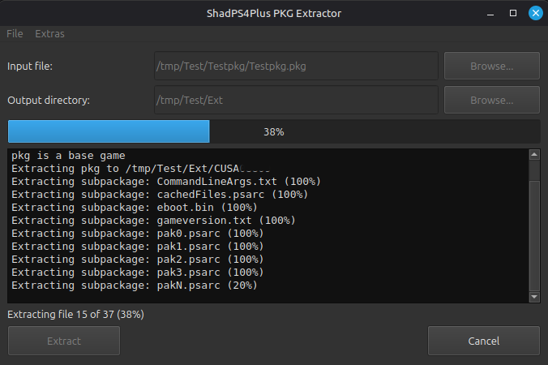

# ShadPS4Plus PKG Extractor

ShadPS4Plus PKG Extractor unpacks PlayStation 4 `.pkg` packages. It provides a Qt desktop interface and a command-line mode, and runs on Windows, Linux, and macOS.

## Acknowledgements

This project is based on [AzaharPlus/shadPS4Plus](https://github.com/AzaharPlus/shadPS4Plus), the original project used as its starting point.

## Features

- Extract base-game, update, and DLC packages via terminal or GUI.
- Multilanguage support. You can add new languages via translations.json

## Screenshots

**Idle interface**


**Extraction in progress**



## Using the GUI

Launch `pkg_extractor.exe` on Windows or `pkg_extractor` on Linux. On macOS, launch `pkg_extractor.app`. Select a PKG file and output directory, then click **Extract**. You can also drag and drop a local file or folder onto the corresponding path field.

## Command line

```text
pkg_extractor <package.pkg> [output-directory]
```

The output directory is optional. When omitted, the extracted title folder is created relative to the current working directory. When provided, the title folder is created inside that directory. Quote paths that contain spaces.

To identify a package type for scripts, run:

```text
pkg_extractor <package.pkg> --check-type
```

The process exit code is `101` for a base game, `102` for an update, and `103` for DLC. A zero or other exit code indicates failure.

## Install scripts

`install_pkg.bat` (Windows) and `install_pkg.sh` (Linux) route base games and updates to ShadPS4's games directory and DLC to its add-ons directory. Before using either script, edit its `gamesDir` and `addonsDir` values to match the paths configured in ShadPS4. The scripts accept a package path as their first argument and can also be used with the included batch-install scripts.

## Download prebuilt builds

The GitHub Actions **Build** workflow creates platform artifacts for Windows, Linux, and macOS on pushes and pull requests, and can also be run manually. Download an artifact from the workflow run's **Artifacts** section:

- `pkg-extractor-windows` contains the Windows executable and its runtime files.
- `pkg-extractor-linux` contains the Linux executable and README.
- `pkg-extractor-macos` contains a zipped, Qt-deployed `.app` bundle.

## Build from source

The project uses CMake, C++23, Qt 6 Widgets, zlib 1.3 or newer, and GNU Make to build the bundled Crypto++ dependency. Use a C++23-capable compiler and install the platform's Qt development packages first.

### Linux

On Ubuntu, install the build dependencies:

```sh
sudo apt-get install build-essential cmake qt6-base-dev zlib1g-dev
```

Then configure and build:

```sh
cmake -S . -B build
cmake --build build --parallel 2
```

The executable is `build/pkg_extractor`.

### macOS

Install CMake, Qt, and zlib (for example, with Homebrew):

```sh
brew install cmake qt zlib
```

Configure with the Homebrew package paths and build:

```sh
cmake -S . -B build \
  -DCMAKE_BUILD_TYPE=Release \
  -DCMAKE_PREFIX_PATH="$(brew --prefix qt);$(brew --prefix zlib)" \
  -DZLIB_USE_STATIC_LIBS=ON
cmake --build build --parallel 2
```

CMake creates `build/pkg_extractor.app`. To bundle Qt frameworks for distribution, run:

```sh
"$(brew --prefix qt)/bin/macdeployqt" build/pkg_extractor.app
```

### Windows

The provided Windows workflow builds with the MSYS2 UCRT64 MinGW toolchain. Install MSYS2 and the packages used by the workflow (`make`, the UCRT64 CMake, Make and toolchain packages, Qt 6 Base, and zlib), then use the **MSYS2 UCRT64** terminal:

```sh
cmake -S . -B build/windows -G "MinGW Makefiles" \
  -DCMAKE_BUILD_TYPE=Release \
  -DCMAKE_PREFIX_PATH=/ucrt64
cmake --build build/windows --parallel 2
```

The executable is `build/windows/pkg_extractor.exe`. For a distributable folder, deploy Qt's runtime files with `windeployqt` and include the matching zlib DLL.
