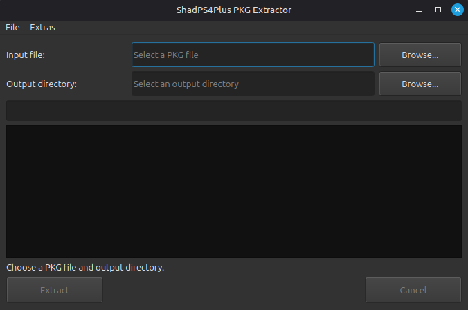

# shadPS4Plus PKG Extractor

A desktop and command-line tool for extracting PlayStation 4 PKG files for use with [shadPS4](https://github.com/shadps4-emu/shadPS4). The project is a rework of [AzaharPlus/shadPS4Plus](https://github.com/AzaharPlus/shadPS4Plus), with a Qt interface and multilingual support.



## Features

- Extract base-game, game-update, and DLC PKG files.
- Use the Qt desktop interface or run the extractor from a terminal.
- In the GUI, choose a PKG and output directory, drag and drop paths into the fields, view extraction progress, and cancel an extraction.
- Automatically classify package content and create the corresponding output layout:
  - Base game: `<output>/<title-id>/`
  - Update: `<output>/<title-id>-patch/`
  - DLC: `<output>/<title-id>/<content-id-part>/`
- Select the interface language in **Extras > Language**. Available translations are English, Chinese (Simplified), Spanish, French, and German. The system language is selected automatically when available; otherwise English is used.

## Usage

### Desktop interface

Run `pkg_extractor` (Linux), `pkg_extractor.exe` (Windows), or the `pkg_extractor.app` bundle (macOS) without arguments. Select a PKG file and an output directory, then click **Extract**. The output directory is the root under which the package-specific layout is created.

### Command line

Pass the PKG path followed by an optional output directory:

```sh
./pkg_extractor /path/to/game.pkg /path/to/output
```

On Windows:

```powershell
.\pkg_extractor.exe C:\path\to\game.pkg C:\path\to\output
```

If the output directory is omitted, files are extracted beneath the current working directory. The extractor creates the package-specific subdirectory described above.

### Optional ShadPS4 install scripts

`install_pkg.sh` and `install_pkg.bat` classify a package and route base games and updates to the configured games directory and DLC to the configured add-ons directory. Before using either script, edit its `gamesDir` and `addonsDir` values to match the paths configured in ShadPS4. The `batch_install.sh` and `batch_install.bat` helpers apply the install script to PKG files in a directory.

## Build

### Requirements

- CMake 3.16 or newer
- A C++23 compiler
- GNU Make (used to build the bundled Crypto++)
- Qt 6 Widgets
- zlib 1.3 or newer

Install the Qt and zlib development packages for your platform. For example, on Ubuntu:

```sh
sudo apt install build-essential cmake qt6-base-dev zlib1g-dev
```

Configure and build from the repository root:

```sh
cmake -S . -B build -DCMAKE_BUILD_TYPE=Release
cmake --build build --parallel
```

The executable is produced in the selected build directory. If CMake cannot locate Qt or zlib, set `CMAKE_PREFIX_PATH` to the relevant installation prefix. The project also has GitHub Actions builds for Linux, macOS, and Windows.

## Adding a translation

Translations are embedded from [`src/common/translations/translations.json`](src/common/translations/translations.json). Add a language entry using a locale code as its key, provide a display name in `_languageName`, and translate the UI strings using the English (`en`) entry as the key list. Missing or empty translations fall back to English, then to the source text. Rebuild the application to include the changes.

## License

This project incorporates code from the shadPS4 Emulator Project, which is licensed under [GPL-2.0-or-later](https://www.gnu.org/licenses/old-licenses/gpl-2.0.html).
